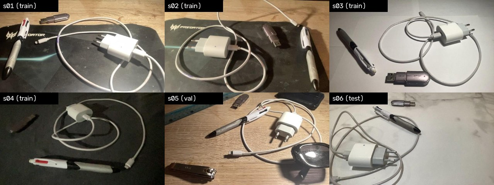
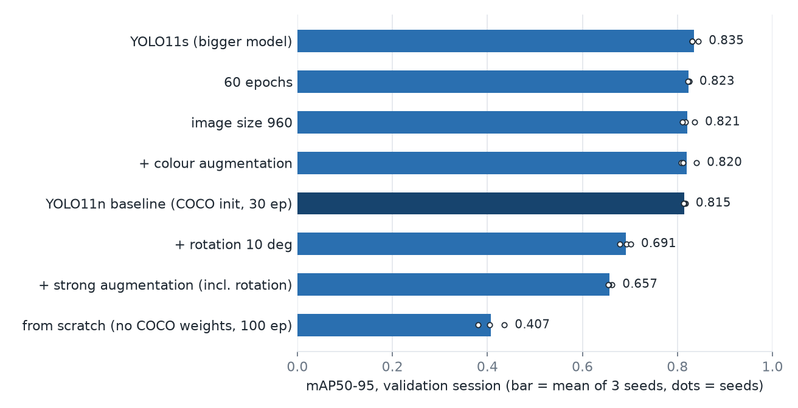
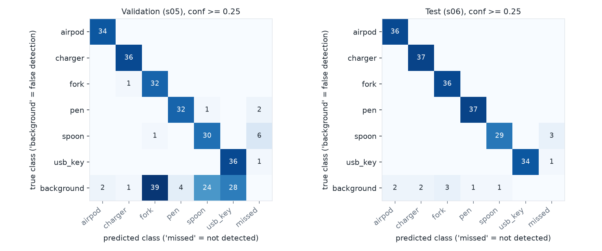
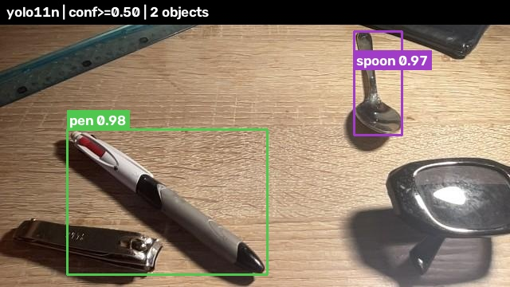

# Tabletop Object Detection for Robotic Perception

Fine-tuning YOLO11 to detect six everyday tabletop objects (pen, USB key, spoon, fork, charger, AirPods case) in real time, trained on a dataset I collected and annotated myself with a MacBook webcam.

**Result on a held-out session (new surface and background, never used for any decision):** YOLO11n reaches **0.98 mAP@0.5 and 0.85 mAP@0.5:0.95**, and runs at **50-70 FPS** on an Apple M1 GPU (MPS). Compared with the COCO-pretrained model used as-is, the fork AP@0.5:0.95 goes from 0.49 to 0.87.


*One frame from each of the six capture sessions (different lighting, surfaces and backgrounds).*

## Why this problem

A robot that picks objects from a table first needs a detector that works on *its own* objects, under *its own* lighting. Off-the-shelf COCO models know only two of my six classes (fork, spoon) and handle them poorly (fork recall 0.41 on my data). So the project covers the whole loop: data collection, annotation, fine-tuning, controlled comparisons, honest evaluation, and a live demo.

## Dataset

479 images (640 px wide, from the MacBook webcam), 1,260 boxes, 6 classes, 22 empty images used as negatives. Collected in six sessions; **a session never shares images between train, validation and test**.

| Session | Lighting | Surface / background | Split |
|---|---|---|---|
| s01 | desk lamp, above | desk + black mouse pad | train |
| s02 | desk lamp, from the side | desk + black mouse pad | train |
| s03 | desk lamp, above | white paper | train |
| s04 | ceiling light + phone flashlight (dim) | dark grey cloth | train |
| s05 | ceiling light + desk lamp | bare wood, cluttered with distractors (ruler, wallet, glasses, nail clipper) | **validation** |
| s06 | living-room light | glossy white marble table | **test** |

| Split | Images | airpod | charger | fork | pen | spoon | usb_key |
|---|---|---|---|---|---|---|---|
| train (s01-s04) | 319 | 139 | 147 | 131 | 132 | 132 | 154 |
| val (s05) | 80 | 34 | 36 | 33 | 35 | 37 | 37 |
| test (s06) | 80 | 36 | 37 | 36 | 37 | 32 | 35 |

Each session follows the same shot list (empty table, single objects, pairs, groups of 3-4, all six objects with partial overlaps, a hand touching an object) - see [`docs/capture_guide.md`](docs/capture_guide.md). Annotation rules (bounding boxes drawn in Roboflow, e.g. `charger` = the power block only, not the cable; objects more than 70% hidden are not labelled) are in [`docs/annotation_rules.md`](docs/annotation_rules.md).

**Why split by session and not at random:** frames of one session are near-duplicates. Roboflow's default random split would put almost identical images in train and test and inflate every metric. [`scripts/make_splits.py`](scripts/make_splits.py) rebuilds the split from the session prefix of each file name. The label audit ([`scripts/audit_labels.py`](scripts/audit_labels.py)) found no invalid or missing boxes.

## Method

- **Model:** YOLO11n (2.6 M parameters) initialised from COCO weights, then fine-tuned. A small model is enough for 319 training images and is fast enough for a live demo; initialisation from COCO matters a lot (see below). A bigger YOLO11s is evaluated as the accuracy-oriented alternative.
- **Training:** 30 epochs, 640 px, batch 16, AdamW (Ultralytics `optimizer=auto`), early stopping on validation fitness, seed fixed. Best epoch chosen on the **validation** session only.
- **Metrics:** mAP@0.5 (is the object found with a reasonable overlap?) and mAP@0.5:0.95 (is the box also tight?), plus per-class precision and recall.
- **Experiments** run on a free Kaggle T4 GPU ([`notebooks/`](notebooks)), one factor changed at a time, **3 seeds each** (a validation set of 80 images is noisy).

## Results

### Final evaluation on the test session (s06, 80 images, evaluated once)

| Model | Precision | Recall | mAP@0.5 | mAP@0.5:0.95 |
|---|---|---|---|---|
| YOLO11n (fine-tuned) | 0.974 | 0.975 | 0.981 | 0.854 |
| YOLO11s (fine-tuned) | 0.979 | 0.973 | 0.982 | 0.869 |

Both candidates and the seed (0) were fixed before looking at the test set. One seed per model: the n-vs-s difference is within noise.

**Versus the COCO model used as-is** (only fork and spoon exist in COCO; the other four classes cannot be detected by it at all):

| Class | AP@0.5: COCO / fine-tuned YOLO11n | AP@0.5:0.95: COCO / fine-tuned YOLO11n |
|---|---|---|
| fork | 0.715 / **0.992** | 0.489 / **0.871** |
| spoon | 0.899 / **0.916** | 0.717 / **0.817** |

Per-class AP@0.5:0.95 of YOLO11n on test: airpod 0.907, charger 0.812, fork 0.871, pen 0.851, spoon 0.817, usb_key 0.866.

### What mattered (validation session, 3 seeds)



| Variant | mAP@0.5:0.95 (mean ± std) | Takeaway |
|---|---|---|
| YOLO11n baseline (COCO init, 30 epochs) | 0.815 ± 0.002 | reference; reproducible across seeds |
| from scratch (no COCO weights, 100 epochs) | 0.407 ± 0.028 | **pre-training is decisive** with 319 images |
| YOLO11s (bigger model) | 0.835 ± 0.007 | +2 points, consistent over seeds, ~2x slower |
| 60 epochs / image size 960 | 0.823 / 0.821 | small or no gain |
| + colour augmentation | 0.820 ± 0.017 | no gain (noise) |
| + rotation 10° | 0.691 ± 0.011 | **hurts by 12 points** |
| + strong augmentation (colour, rotation, translate, mixup) | 0.657 ± 0.004 | hurts |

The rotation result is consistent with axis-aligned boxes becoming looser around a rotated object (not verified directly). Raw numbers: [`results/`](results), full log: [`docs/results.md`](docs/results.md).

### Errors



On the test session almost every object is found and correctly labelled (`spoon` is the weakest: 3 missed). On the validation session, which I built to be cluttered, the model produces many **false detections at low confidence** (confidence ≥ 0.25), on the distractors: the nail clipper is detected as a fork (I did not break down the other false boxes by cause). Raising the confidence threshold to 0.5 (the demo default) removes most of them.

### Speed (Apple M1, 8 GB, 640×360 frames, full pipeline without camera and drawing)

| Model | GPU (MPS) | CPU (1 thread) |
|---|---|---|
| YOLO11n | 52-69 FPS | 20 FPS |
| YOLO11s | 26-28 FPS (NMS post-processing dominates, not investigated) | 11 FPS |

## Limitations

- **The test session is not harder than the validation session.** Test scores (0.98 mAP@0.5) are *higher* than validation scores (0.94): s06 is a clean scene, whereas s05 was deliberately cluttered. I checked for leakage (disjoint sessions, no shared files, test images farther from train images than train images are from each other) and found none, but the test number should not be read as "generalises better than validation". It means the two scenes differ in difficulty.
- **Small, single-environment dataset:** 479 images, one person, one room, one set of six objects, one webcam. No claim is made about other objects, cameras or rooms.
- **One seed per model on the test set, 80 images:** differences of one or two points are not significant.
- **Sensitivity to the viewpoint:** at least one validation frame (`s05_071`), captured from a much wider angle than the rest of the data, shows missed or mislabelled objects. I did not measure this systematically.
- **YOLO11s false positives:** on test it adds low-confidence (0.27-0.51) false `spoon` boxes in 19 of 80 images (mostly a small box on a dark marble vein in the top-left corner; once the phone). YOLO11n has far fewer.
- **Training time:** the first run on the Mac took 1.5 hours (8 GB of RAM, swapping); the same run takes about two minutes on a Kaggle T4.

## Run it

```bash
python3 -m venv .venv && source .venv/bin/activate
pip install -r requirements.txt
```

**Live demo** (webcam; weights are in [`weights/`](weights)):

```bash
python scripts/demo.py                  # YOLO11n, confidence 0.5
python scripts/demo.py --model yolo11s
python scripts/demo.py --camera 1       # if an iPhone is picked up as camera 0 (Continuity Camera)
```

Keys: `q` quit, `m` switch model, `+`/`-` confidence threshold, `s` save a screenshot. To annotate a folder of images instead: `python scripts/demo.py --images <folder> --out screenshots/demo`.


*Demo output on a validation image (confidence ≥ 0.5).*

**Reproduce the pipeline** (the images are personal photos and are not in this repository; scripts expect `data/dataset/{train,val,test}/{images,labels}` in YOLO format, described by [`data/dataset.yaml`](data/dataset.yaml)):

```bash
python scripts/capture.py --session s01                      # capture with the webcam (see --list for cameras)
python scripts/audit_labels.py data/_export_v2               # check a Roboflow YOLO export
python scripts/make_splits.py data/_export_v2                # split by session
python scripts/train.py --name yolo11n_e30 --model yolo11n.pt --epochs 30
python scripts/evaluate.py --weights runs/yolo11n_e30/weights/best.pt --name yolo11n_e30   # val; test needs --final
python scripts/baseline_coco.py --name coco_yolo11n          # COCO zero-shot on fork / spoon
python scripts/benchmark_fps.py --weights yolo11n=weights/yolo11n_tabletop.pt
python scripts/make_figures.py
```

## Repository layout

```
scripts/      capture, audit, split, train, evaluate, baseline, benchmark, demo, figures
notebooks/    Kaggle notebooks for the controlled experiments (6 variants x 3 seeds, augmentation ablation)
results/      raw metrics (CSV / JSON) behind every number in this README
docs/         capture guide, annotation rules, full results log, figures
weights/      final weights: YOLO11n and YOLO11s (seed 0)
```

## License

[Ultralytics YOLO](https://github.com/ultralytics/ultralytics) is released under AGPL-3.0; the trained weights and code that depend on it are subject to that license. The photos are personal and are not distributed.
